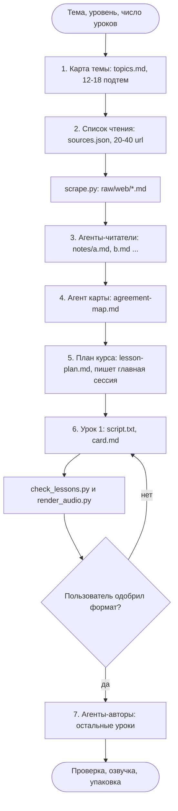

# Как устроен claudemy

Разбор оригинала `assafkip/claudemy` (коммит `cd81cc8`, 14.10.2026) перед адаптацией под русский язык и наши стандарты. Основа - чтение всего кода и пробный прогон на теме «LLM inference serving».

## Что это

Claudemy - скилл Claude Code. Пользователь называет тему, скилл ищет источники в вебе, сводит их и выдаёт курс: около 12 аудиоуроков по 2 минуты, карточку на урок и сводный playbook (правила на память). Лицензия MIT.

Состав:

| Часть | Размер | Роль |
|---|---|---|
| `SKILL.md` | 9,6 КБ | сценарий для главной сессии: 7 шагов, правила честности |
| `references/reader-brief.md` | 2,4 КБ | задание агенту-читателю: страницы в заметки со ссылками |
| `references/map-brief.md` | 1,9 КБ | задание агенту карты: заметки в темы с подсчётом согласия |
| `references/writer-brief.md` | 3,1 КБ | задание агенту-автору: скрипт урока и карточка |
| `references/lesson-design.md`, `lesson-example.md` | 4,3 КБ | формат урока и образец |
| `scripts/scrape.py` | 11,6 КБ | скачивание страниц в markdown |
| `scripts/check_lessons.py` | 4,4 КБ | проверка уроков и плана |
| `scripts/render_audio.py` | 4,9 КБ | озвучка и склейка |
| `scripts/package_class.py` | 2,4 КБ | zip с аудио и общий файл карточек |

Почти вся логика лежит в промптах. Код делает только то, что модели доверять нельзя: скачивание, проверку ссылок, звук.

## Поток

Рисунок 1 - поток claudemy. Источник: `SKILL.md`, шаги 1-7.

Как читать: шаги 1, 2 и 5 делает главная сессия. Шаги 3, 4 и 7 делают субагенты параллельно. Ромб - единственная остановка, где ждут человека.

## Шаги подробно

1. **Карта темы.** Главная сессия ищет, как тему обычно преподают, и пишет 12-18 подтем `T01`-`T18`. Все заметки дальше раскладываются по этим идентификаторам, поэтому источники можно сравнить.
2. **Список чтения.** Сессия ищет 20-40 страниц: практики, документация, исследования, несколько несогласных. С одного сайта не больше 3 страниц. В список идут только url, которые сессия видела в выдаче: в тесте автора 12 из 34 предложенных моделью url оказались мёртвыми. `scrape.py` скачивает страницы и называет каждую отброшенную: ошибка HTTP, платный доступ, меньше 150 слов.
3. **Чтение.** Агенты-читатели получают по 8 страниц и пишут 20-50 заметок. У каждой заметки есть url, вид (техника, число, ошибка, история), уровень и пометка о заинтересованности источника.
4. **Карта согласия.** Один агент сводит заметки в 30-45 тем. У темы есть счёт «N из M»: M - страницы, которые касались подтемы, N - страницы, которые поддерживают идею. Тема с M меньше 3 помечается как слабая.
5. **План курса.** Главная сессия сама пишет план: блоки по 4 урока, от основ к спорному. В конце плана - разделы «Splits» (где источники расходятся) и «Coverage gaps» (что не покрыто).
6. **Пробный урок.** Сессия пишет, проверяет и озвучивает урок 1 и ждёт реакции. Замечания пользователя становятся образцом для остальных уроков.
7. **Остальные уроки.** Агенты-авторы пишут по 4 урока, копируя одобренный урок 1. Урок, который не прошёл проверку три раза, попадает в отчёт, а не в цикл.

## Что гарантирует код

`check_lessons.py` проверяет каждый урок и план:

| Проверка | Правило |
|---|---|
| формат скрипта | каждая строка `A: ...` или `B: ...` |
| длина | 280-350 английских слов, это около 2:00-2:30 |
| аудиотеги | не больше 3: `[laughs]`, `[chuckles]`, `[sighs]` |
| тон | нет фраз-требований `you must`, `you should`, `make sure` |
| символы | нет длинного тире и `--` |
| карточка | есть 8 обязательных разделов |
| ссылки | каждый url карточки и плана есть в строке `url:` файла из `raw/` |

Таблица 1 - проверки `check_lessons.py`.

Последняя проверка - главная. Модель не может сослаться на страницу, которую никто не скачал.

`render_audio.py` разбирает строки `A:`/`B:`. С ключом ElevenLabs он отправляет пачки до 3000 символов в Text-to-Dialogue (модель `eleven_v3`). Без ключа он озвучивает каждую реплику через macOS `say`. Затем ffmpeg склеивает части, выравнивает тембр и громкость (`loudnorm=I=-16`). Скрипт пишет реальную длительность в строку `Listen` карточки.

## Где зашит английский

| Место | Что | Что менять |
|---|---|---|
| `check_lessons.py`, `WORDS_MIN/MAX` | диапазон откалиброван на английском темпе | замерить русский темп |
| `check_lessons.py`, `DEMAND` | список фраз только на английском | русский список или убрать |
| `check_lessons.py`, `CARD_SECTIONS` | заголовки карточки на английском | русские заголовки |
| `render_audio.py` | голоса Samantha и Daniel, ElevenLabs | локальный русский движок |
| все `references/*.md` | промпты и образец урока на английском | переписать |
| `scrape.py` | только веб-страницы, видео нет | субтитры видео через `yt-dlp` |

Таблица 2 - зависимость от английского.

## Пробный прогон

Условия: тема «LLM inference serving», 4 урока вместо 12, голоса macOS, отдельная headless-сессия `claude -p`. Результат лежит в `claudemy-workspace/llm-inference-serving/` (каталог в `.gitignore`), аудио - в `deliver/audio-lessons-01-to-04.zip`.

| Показатель | Значение |
|---|---|
| время | 42 минуты в двух заходах: 23 и 19 |
| источники | 36 url в списке, 32 страницы скачаны, 4 отброшены (таймаут, HTTP 429) |
| заметки и карта | 4 файла заметок по 28-33 КБ, карта согласия 50 КБ, 45 тем |
| уроки | 4 урока, 8:04 аудио, все прошли `check_lessons.py` |
| токены Opus | 131 тыс. на выходе, 9,5 млн чтения из кэша |
| токены Sonnet | 99 тыс. на выходе, 2,1 млн чтения из кэша |
| токены Haiku | 17 тыс. на выходе, 18 веб-поисков |
| цена по прайсу API | $10,41; на подписке это расход лимита, денег не списано |

Таблица 3 - пробный прогон.

Что увидели:

1. Уроки конкретные. В каждом есть цифры из источника со ссылкой: 2 ГБ кэша на запрос в 4 тыс. токенов у Llama 2 7B (NVIDIA), бюджет 14 ГБ на A100 40 ГБ (Anyscale).
2. Автор пишет числа так, как их произносят: «seven B», «forty gig». Это правило есть в `writer-brief.md`. Для русского его нужно расширить на английские термины.
3. Первый заход оборвался: главная сессия запустила агента карты в фоне и закончила ход, агент погиб. Второй заход шёл на переднем плане.
4. Главная сессия отступила от сценария: уроки 2-4 написала сама, без агентов-авторов. Сценарий скилла не держит порядок шагов жёстко.
5. Баг в `render_audio.py`, функция `stamp_card`: регулярное выражение съедает пустую строку после `**Listen:**`, две строки карточки слипаются.
6. Основной расход - Opus главной сессии: она держит в контексте заметки и карту на 170 КБ.

## Выводы для форка

- Процесс и проверка ссылок переносятся без изменений: это ядро ценности.
- Под русский переписываются промпты, проверка длины и тона, озвучка.
- В headless-режиме фоновые агенты гибнут, когда сессия заканчивает ход. Шаги с агентами нужно ждать на переднем плане.
- `scrape.py` не умеет видео. Для видео нужен отдельный путь через субтитры.
- Курс на 12 уроков по цифрам прогона обойдётся примерно в 2-3 раза дороже 4 уроков: поиск и чтение растут медленнее, чем число уроков. Это оценка, не замер.
