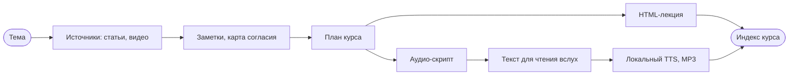

# Платформа обучения: источники, стандарты, доставка

Факты и варианты для глобальной спеки форка. Решения здесь не принимаются: каждый раздел заканчивается вопросами к спеке. Устройство оригинала - `claudemy.md`, озвучка - `tts.md`.

## Что уже есть у нас

| Что | Где | Что берём |
|---|---|---|
| стандарт теории | `~/.claude/rules/theory.md` | тон, абзац, термины, примеры, запреты, холодное чтение |
| стандарт HTML-страниц | `~/.claude/rules/html-pages.md`, шаблон `~/.claude/templates/page.html` | лекция с оглавлением, inline SVG, `lychee`, скриншот |
| библиотека лекций | `~/Dev/self-projects/growth/lectures/`, 10 лекций и `index.html` | место для HTML-лекций |
| скилл `theory-notes` | `~/.claude/skills/theory-notes/` | видео через субтитры `yt-dlp`, кандидаты на утверждение |
| прототип `podcast-tts` | `~/Documents/diploma/podcast/podcast-tts/` | диалог в markdown, два голоса Piper, MP3; идеи: главы, RSS |
| `ai-dev-digest` | `~/Dev/self-projects/ai-dev-digest/` | решения в коде, текст у модели; WebFetch у YouTube видит только описание |
| homelab | Raspberry Pi 4, nginx, `homelab.local`, HDD 4 ТБ | хостинг файлов и RSS в домашней сети |

Таблица 1 - готовое у нас.

## Источники

Оригинал работает только с веб-страницами (`scrape.py`). Страницы на любом языке скачиваются одинаково: скрипт берёт текст из `<article>` или `<main>`.

Видео:

1. `yt-dlp --list-subs` показывает субтитры. Проверено на видео `kCc8FmEb1nY`: есть `en-orig`, `en`, `ru`, `ru-orig`.
2. Субтитры скачиваются без видео (`--skip-download --write-auto-subs`), как в `theory-notes`.
3. Видео без субтитров: локальное распознавание. В mlx-audio есть Whisper large-v3-turbo (99 языков) и Canary (25 языков ЕС, русский, украинский). На этом Mac не проверял.

Чтобы видео прошло проверку ссылок, файл в `raw/` получает строку `url:` с адресом видео. Таймкод в карточке - ссылка `&t=СЕКУНДЫ`, по `theory.md`.

Вопросы к спеке:

- Видео - полноправный источник в автоматическом поиске или только по ссылке пользователя?
- Заметки читателей пишутся по-русски или на языке источника?

## Стандарты: где форматы расходятся

| Тема | claudemy | наш стандарт | Варианты |
|---|---|---|---|
| тон аудио | энергичный, реакции, теги `[laughs]` | спокойный, без шуток (`theory.md`, «Тон») | спокойный диалог; энергичный только в аудио |
| цель урока | навык, практика «Try it» | механизм на примерах с настоящими значениями | механизм в HTML, практика в карточке |
| код и схемы | нет | обязательны | только в HTML; в аудио словами |
| объём | 12 уроков по 2 минуты | тема до 12 КБ | урок = раздел лекции; лекция = блок из 4 уроков |
| отбор источников | 20-40 страниц автоматически | 3-7 кандидатов на утверждение | авто с показом списка; утверждение списка |
| счёт согласия | «N из M источников» в каждом уроке | нет | оставить: это защита от одиночного мнения |
| проверка | `check_lessons.py` | холодное чтение агентом, парсер Mermaid, `lychee` | оба: код по форме, агент по смыслу |
| playbook | одно правило на урок в общем файле | нет | оставить или убрать |

Таблица 2 - конфликты форматов.

Гипотеза связки: одна база исследования (заметки и карта согласия) даёт два вывода. HTML-лекция несёт то, что нельзя услышать: код, схемы, таблицы. Аудио несёт идею и механизм словами и ссылается на раздел лекции.

Рисунок 1 - гипотеза: одно исследование, два вывода.

Как читать: всё до плана курса общее. После плана путь делится на HTML и аудио, индекс курса связывает их. Шаг «Текст для чтения вслух» обязателен: см. `tts.md`, раздел «Латиница и цифры».

Вопросы к спеке:

- Аудио повторяет лекцию или дополняет её?
- Один голос или диалог двух ведущих?
- Длина урока: 2 минуты, как в оригинале, или 5-10?

## Доставка

| Вариант | Как слушать | Что нужно | Ограничение |
|---|---|---|---|
| папка курса и `index.html` с `<audio>` | браузер на Mac | ничего | на телефон вручную |
| `growth/lectures/` | браузер на Mac | ссылка из `index.html` | то же |
| RSS-подкаст на homelab | подкаст-приложение на телефоне | nginx отдаёт `feed.xml` и MP3 | только домашняя сеть или VPN |
| RSS на GitHub Pages | любое подкаст-приложение | публичный репозиторий | курс виден всем |
| Telegram «Избранное» или свой канал | Telegram на телефоне | бот или MCP Telegram | отдельная интеграция |

Таблица 3 - варианты доставки.

Вопросы к спеке:

- Где ты слушаешь: дома, в дороге, за компьютером?
- Курсы личные или публичные?

## Расход

Пробный прогон оригинала в headless-сессии на 4 урока: цифры - в `claudemy.md`, раздел «Пробный прогон». Субагенты по умолчанию запрещены глобальными правилами, а оригинал строит на них чтение и написание уроков.

Вопрос к спеке: разрешить субагентов в профиле проекта или перевести шаги на один поток?
